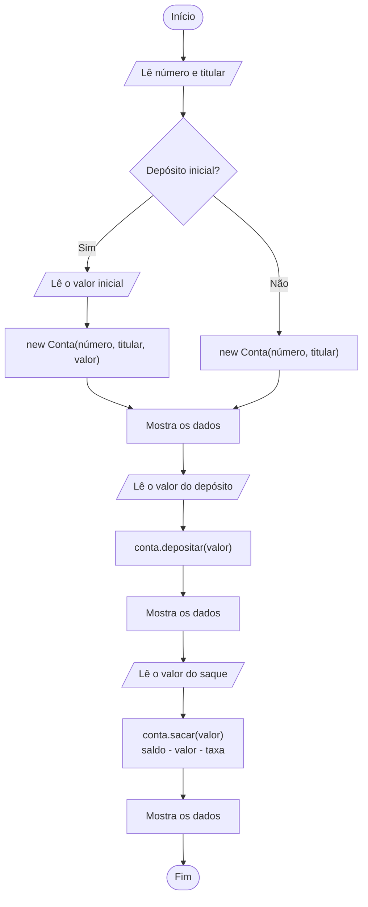
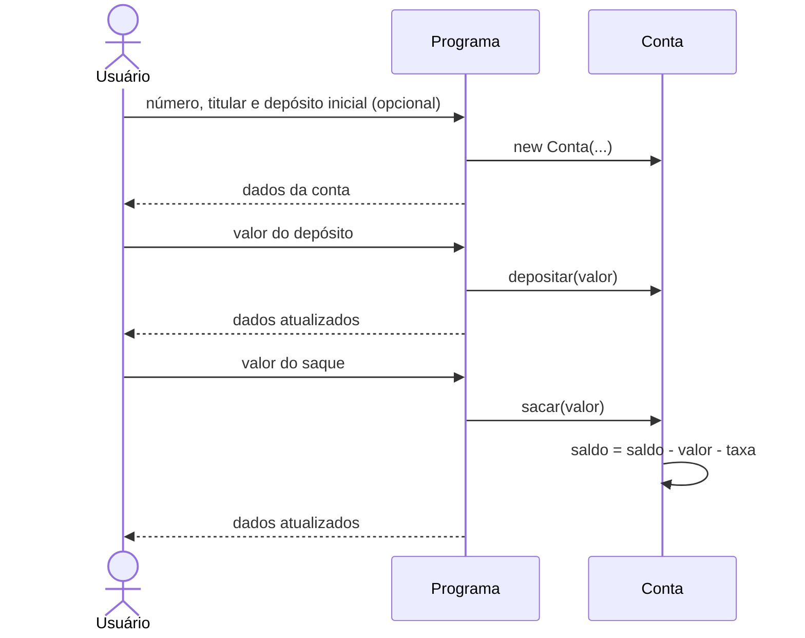
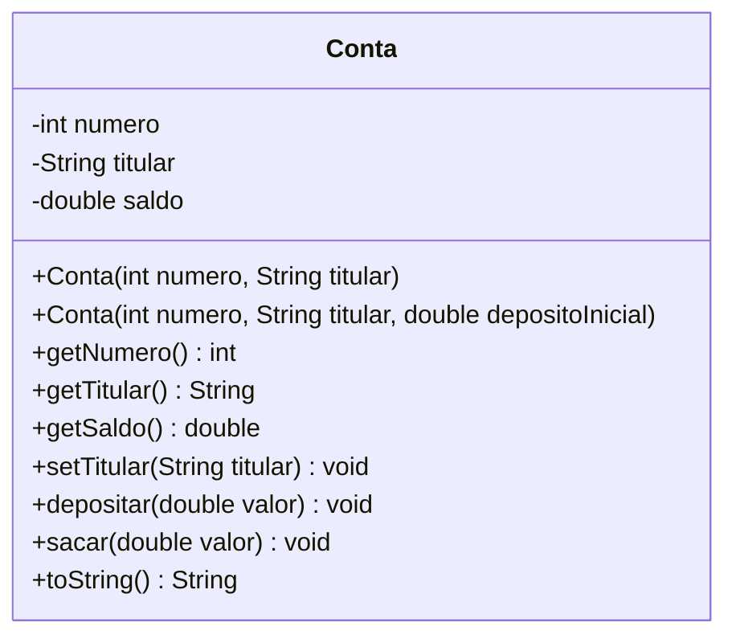

<p align="center">
  
</p>

<p align="center">
  
  
  
  
  
</p>

<p align="center">
  <a href="#funcionalidades">Funcionalidades</a> ·
  <a href="#como-funciona">Como funciona</a> ·
  <a href="#regras-de-negócio">Regras</a> ·
  <a href="#perguntas-e-respostas">Perguntas e respostas</a> ·
  <a href="#como-executar">Executar</a> ·
  <a href="#exemplos-de-uso">Exemplos</a>
</p>

---

Programa de console em Java que abre uma conta bancária, com depósito inicial opcional, faz um depósito e um saque, e mostra os dados da conta depois de cada operação.

Exercício de fixação do curso **Java COMPLETO: Programação Orientada a Objetos + Projetos**, do professor Nélio Alves (Udemy).

## Funcionalidades

- 🏦 Abre a conta com número, titular e depósito inicial **opcional**
- 💰 Faz depósitos
- 💸 Faz saques com taxa de $ 5.00
- 📋 Mostra os dados da conta após cada operação
- 🔒 Protege número e saldo contra alteração direta

## Como funciona

O fluxo do programa, do cadastro ao último saque:



<details>
<summary><b>Ver a conversa entre o Programa e a Conta</b></summary>



O `Programa` só lê e imprime. Quem decide o que acontece com o saldo é sempre a `Conta`.

</details>

<details>
<summary><b>Ver o modelo da classe Conta</b></summary>



O sinal `-` marca o que é privado e o `+` o que é público. Repare que não existem `setNumero` nem `setSaldo`.

</details>

## Regras de negócio

| Dado | Regra |
|---|---|
| 🔢 Número | Informado na abertura e **nunca** pode ser alterado |
| 👤 Titular | Informado na abertura e **pode** ser alterado |
| 💵 Saldo | Começa em zero, ou no depósito inicial. Só aumenta por depósito e só diminui por saque |
| 🧾 Taxa de saque | $ 5.00 por saque |
| 📉 Saldo negativo | Permitido quando o saldo não cobre o saque e a taxa |

A conta do saque é sempre:

```
saldo final = saldo atual − valor sacado − 5.00
```

| Saldo antes | Saque | Saldo depois |
|---:|---:|---:|
| 700.00 | 300.00 | 395.00 |
| 100.00 | 50.00 | 45.00 |
| 1000.00 | 995.00 | 0.00 |
| 20.00 | 50.00 | -35.00 |

## Perguntas e respostas

<details>
<summary><b>Por que o saldo não tem setter?</b></summary>

<br>

Se qualquer parte do programa pudesse escrever `conta.setSaldo(1000)`, a regra "o saldo só aumenta por depósito e só diminui por saque" deixaria de valer. Sem o setter, só `depositar` e `sacar` conseguem mexer nele, e o saque sempre cobra a taxa.

</details>

<details>
<summary><b>Por que o número também não tem setter?</b></summary>

<br>

Porque o enunciado diz que, depois de aberta a conta, o número nunca pode mudar. O número entra uma vez, pelo construtor, e a partir daí só pode ser lido.

</details>

<details>
<summary><b>Por que existem dois construtores?</b></summary>

<br>

Porque o depósito inicial é opcional. Um construtor recebe só o número e o titular, e o outro recebe também o valor inicial. Isso se chama **sobrecarga**: mesmo nome, parâmetros diferentes. O segundo reaproveita o método `depositar`, então a regra de aumentar o saldo fica em um lugar só.

</details>

<details>
<summary><b>O que acontece se o saque for maior que o saldo?</b></summary>

<br>

A conta fica com saldo negativo. O enunciado permite isso, então o programa não bloqueia o saque. Veja o último caso da tabela acima.

</details>

<details>
<summary><b>Por que usar Locale.US?</b></summary>

<br>

Em computadores configurados em português, o Java espera vírgula como separador decimal. Com `Locale.US`, o ponto funciona tanto na leitura (`500.00`) quanto na impressão, independente do idioma do sistema.

</details>

## Estrutura do projeto

```
.
├── assets
│   └── banner.svg
├── .gitignore
├── README.md
└── src
    └── ExContaBancaria
        ├── Dominio
        │   └── Conta.java
        └── Teste
            └── Programa.java
```

| Arquivo | Papel |
|---|---|
| `Conta.java` | Guarda os dados da conta e as regras de depósito e saque |
| `Programa.java` | Lê os dados, cria a conta e executa as operações |

## Como executar

**Pré-requisito:** JDK 17 ou superior. Para conferir, rode `java -version`.

Primeiro, baixe o projeto:

```bash
git clone https://github.com/novaessoftware/Projetinho-Conta-Bancaria.git
cd Projetinho-Conta-Bancaria
```

<details>
<summary><b>Pela IDE (IntelliJ IDEA)</b></summary>

<br>

1. Abra a pasta do projeto no IntelliJ
2. Abra `Programa.java`
3. Clique no botão de executar ao lado do método `main`

</details>

<details>
<summary><b>Pelo terminal</b></summary>

<br>

```bash
javac -d out src/ExContaBancaria/Dominio/Conta.java src/ExContaBancaria/Teste/Programa.java
java -cp out ExContaBancaria.Teste.Programa
```

</details>

## Exemplos de uso

Digite os valores na ordem em que o programa pergunta.

<details open>
<summary><b>Com depósito inicial</b></summary>

<br>

| Número | Titular | Depósito inicial | Valor inicial | Depósito | Saque |
|---|---|---|---|---|---|
| 8021 | Ana Souza | sim | 500.00 | 200.00 | 300.00 |

| Etapa | Saldo |
|---|---:|
| Conta aberta | 500.00 |
| Depois do depósito | 700.00 |
| Depois do saque (300.00 + taxa de 5.00) | **395.00** |

</details>

<details>
<summary><b>Sem depósito inicial</b></summary>

<br>

| Número | Titular | Depósito inicial | Depósito | Saque |
|---|---|---|---|---|
| 8054 | Bruno Lima | não | 200.00 | 300.00 |

| Etapa | Saldo |
|---|---:|
| Conta aberta | 0.00 |
| Depois do depósito | 200.00 |
| Depois do saque (300.00 + taxa de 5.00) | **-105.00** |

</details>

## Conceitos praticados

- [x] Encapsulamento: atributos privados, getters, e setter só onde faz sentido
- [x] Sobrecarga de construtores
- [x] Regra de negócio dentro da classe, e não no `main`
- [x] Sobrescrita do `toString` com `String.format("%.2f", ...)`
- [x] Entrada de dados com `Scanner` e `Locale.US`
- [x] Versionamento com Git e publicação no GitHub

## Ideias de evolução

- [ ] Validar valores negativos em depósito e saque
- [ ] Repetir operações em um menu até o usuário escolher sair
- [ ] Guardar várias contas em uma lista
- [ ] Escrever testes com JUnit

## Autor

Feito por [@novaessoftware](https://github.com/novaessoftware) nos estudos de Java e programação orientada a objetos.